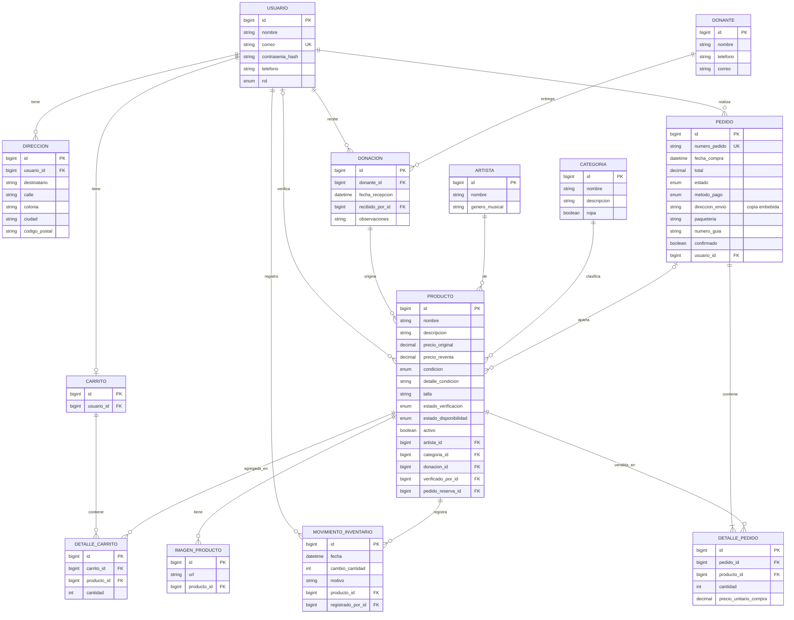

# Studio 21

Proyecto para la materia de Aplicaciones Web. La idea es una tienda de reventa de mercancía original de artistas que se obtiene mediante donaciones.

Cada producto representa una pieza única. Por eso se muestra su condición, talla cuando es ropa, precio de reventa y estado de disponibilidad. También se revisa su autenticidad antes de publicarla.

## Avance 3 · Módulos de administración

El panel de administración (`/admin/**`) funciona con base de datos MySQL. Solo los usuarios con rol `ADMIN` pueden entrar.

| Módulo | Ruta | Qué permite |
|---|---|---|
| Inicio de sesión | `/admin/login` | Login contra la base de datos con contraseña cifrada con BCrypt |
| Cierre de sesión | `/admin/logout` | Invalida la sesión HTTP y regresa al login |
| Resumen | `/admin` | Contadores de piezas y pedidos recientes |
| Productos | `/admin/productos` | Alta, edición con fotografía (Cloudinary), eliminación, publicar y retirar |
| Autenticidad | `/admin/autenticidad` | Verificar o rechazar piezas pendientes |
| Donaciones | `/admin/donaciones` | Registrar donaciones y donantes, ver el detalle y sus piezas |
| Inventario | `/admin/inventario` | Movimientos físicos (+1 / −1) y ajustes con motivo |
| Pedidos | `/admin/pedidos` | Registrar pago, preparación, envío, entrega o cancelación |
| Categorías | `/admin/categorias` | CRUD completo |
| Artistas | `/admin/artistas` | CRUD completo |

## Arquitectura en capas

```
controller/admin  → @Controller, uno por dominio. Recibe la petición y devuelve la vista (patrón POST/Redirect/GET).
service           → @Service con las reglas de negocio y validaciones.
repository        → interfaces Spring Data JPA (@Repository). Único acceso a datos.
model / enums     → entidades JPA y sus estados (sin cambios respecto al diseño original).
config            → SecurityConfig (SecurityFilterChain, formLogin, logout, BCrypt, CSRF), WebConfig y CloudinaryConfig.
templates/admin   → vistas Thymeleaf que reutilizan la cabecera y el menú lateral de fragments/layout.html.
```

Seguridad (Spring Security):

- `SecurityConfig` define el `SecurityFilterChain`: `/admin/**` exige el rol `ADMIN` y `/admin/login` es pública. Sin sesión de administrador, cualquier ruta del panel redirige al login.
- El login es un formulario propio (`formLogin`). `UsuarioService` implementa `UserDetailsService`: busca al usuario por correo en la base de datos y solo deja entrar a los de rol `ADMIN`. La contraseña se compara con BCrypt.
- El logout (`POST /admin/logout`) invalida la sesión HTTP, borra la cookie y redirige a `/admin/login?logout`.
- CSRF queda habilitado por defecto. Todos los formularios usan `th:action`, así que llevan su token automáticamente.

Fotografías:

- Se suben a Cloudinary (`CloudinaryConfig` y `ProductoService`) y en la base de datos queda su URL https en `ImagenProducto`.
- Como alternativa sin nube, `ProductoService` conserva `guardarImagenLocal`, que las guarda en `src/main/resources/static/uploads/`.

## Cumplimiento del Avance 3

| Requisito | Dónde se cumple |
|---|---|
| Acceso protegido con Spring Security; solo rol administrador | `SecurityConfig` (`hasRole("ADMIN")`) y `UsuarioService.loadUserByUsername` |
| Login por formulario validando contra la base de datos | `admin/login.html` + `formLogin` + `UsuarioService` |
| Logout con invalidación de sesión y redirección al login | `logout()` en `SecurityConfig` y botón en la cabecera |
| Bloqueo de rutas del panel sin sesión y redirección al login | `SecurityFilterChain` sobre `/admin/**` |
| Contraseñas con BCrypt | `PasswordEncoder` en `SecurityConfig` y hashes en `datos-mock.sql` |
| Vistas Thymeleaf con layout reutilizable de cabecera y menú lateral | `fragments/layout.html` (`cabecera`, `menu`) |
| Un `@Controller` por dominio con POST/Redirect/GET | `controller/admin/*` |
| Lógica de negocio en `@Service` | `service/*` |
| Persistencia con Spring Data JPA | `repository/*` |
| `/admin/login` pública y CSRF habilitado | `SecurityConfig` |
| Datos mock de administrador | `datos-mock.sql` |
| Modelo de datos | Diagrama de abajo y `docs/modelo-datos.png` |

## Modelo de datos

También está como imagen en `docs/modelo-datos.png`.



## Tecnologías

- Java 21, Spring Boot y Maven.
- Spring Web, Thymeleaf, Spring Data JPA, MySQL y Spring Security (BCrypt y CSRF).
- Cloudinary para guardar las fotografías de los productos.
- HTML y CSS.

## Cómo ejecutarlo

1. Ten MySQL encendido y ajusta usuario y contraseña en `src/main/resources/application.properties`. La base `studio21db` se crea sola.
2. Pon tus credenciales de Cloudinary (`cloudinary.cloud_name`, `cloudinary.api_key`, `cloudinary.api_secret`) en `application.properties`. No las subas a un repositorio público.
3. Abre en IntelliJ IDEA la carpeta que contiene `pom.xml`, configura el JDK 21 y carga el proyecto como Maven.
4. Ejecuta `Studio21Application.java` una vez para que JPA cree las tablas.
5. Ejecuta `datos-mock.sql` en MySQL Workbench para insertar los administradores y datos de ejemplo.
6. Abre [http://localhost:8080/admin](http://localhost:8080/admin) e inicia sesión con `sofia.rivas@studio21.com` / `admin123`.

La tienda pública ([http://localhost:8080/](http://localhost:8080/)) sigue mostrando el maquetado con datos de ejemplo de `DatosMaquetado.java`.
